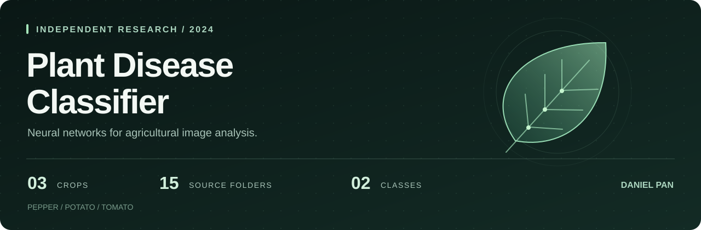

# Plant Disease Classifier

**Independent research on classifying healthy and diseased leaves with neural networks.**

A Python research project by **Daniel Pan** exploring image preprocessing, multilayer perceptron (MLP) experiments, and a zero-shot CLIP baseline on PlantVillage images. The task is binary classification across pepper, potato, and tomato leaves.

[Read the preprint](https://doi.org/10.58445/rars.1772) · [Explore the implementation](plantDisease.py) · [Methods & evaluation notes](docs/RESEARCH_NOTES.md)

## Research at a glance

| Research question | Can a neural network distinguish healthy from diseased leaves using image pixels? |
| :--- | :--- |
| Data | 15 PlantVillage source folders spanning 3 crops, mapped to 2 labels |
| Main model | scikit-learn MLP trained on flattened, normalized RGB images |
| Experiments | Hidden-layer and learning-rate sweeps, loss curves, and confusion matrices |
| Reported result | **88.06% classification accuracy** in the October 2024 preprint |
| Research output | *Enhancing Agricultural Diagnostics: Neural Network-Based Plant Disease Identification* |

The accuracy above is a historical result reported in the preprint; it has not been independently reproduced in this repository refresh. The code is an exploratory research implementation. See the [evaluation notes](docs/RESEARCH_NOTES.md#evaluation-scope) for the limits of the MLP/CLIP comparison.

## What the code does

- **Prepares images:** converts leaves to RGB, resizes to 128 × 128 pixels, flattens each image into 49,152 features, and normalizes pixel values.
- **Runs controlled parameter sweeps:** varies hidden layers across `(50,)`, `(100,)`, and `(100, 50, 25)`; separately varies learning rate across `0.001`, `0.01`, and `0.1`.
- **Evaluates predictions:** uses a fixed-seed 80/20 train/test split, prints accuracy, and exports sweep loss curves and confusion matrices.
- **Explores transfer learning:** includes an optional zero-shot baseline using `openai/clip-vit-base-patch16` through Hugging Face Transformers.

**Stack:** Python · NumPy · scikit-learn · Pillow · Matplotlib · PyTorch · Transformers

## Run the experiments

### 1. Set up the environment

Use Python 3.11 with the dependency versions specified in [requirements.txt](requirements.txt).

```bash
git clone https://github.com/danielpan01/PlantDiseaseClassifier.git
cd PlantDiseaseClassifier
python -m venv .venv
source .venv/bin/activate
python -m pip install -r requirements.txt
```

On Windows, activate the environment with `.venv\Scripts\activate`.

### 2. Add the dataset

Download the [PlantVillage dataset used in the research](https://www.kaggle.com/datasets/emmarex/plantdisease). Place its class directories directly inside a `PlantVillage/` folder at the repository root.

For example, a healthy potato image should be located at `PlantVillage/Potato___healthy/<image>.JPG`. All 15 expected folders must be present. The loader accepts **uppercase `.JPG`** extensions; see the [complete folder list and cache behavior](docs/RESEARCH_NOTES.md#dataset-layout).

### 3. Train and evaluate

```bash
python plantDisease.py
```

This runs six sweep configurations followed by a final MLP fit. Accuracy is printed to the terminal; sweep figures are saved under `DataPlotting/`. Image arrays are cached as `saved_imgs_*.npz`. The full image matrix and repeated MLP fits can require substantial memory and runtime.

To run the optional CLIP experiment separately:

```bash
python -c "from plantDisease import deep_model; deep_model()"
```

The first CLIP run downloads pretrained model weights. Its evaluation uses a different protocol from the MLP; consult the methods notes before interpreting the two scores together.

## Repository guide

| File | Purpose |
| :--- | :--- |
| [plantDisease.py](plantDisease.py) | Data loading, preprocessing, training, evaluation, and plotting |
| [requirements.txt](requirements.txt) | Dependency version ranges for the original experiments |
| [docs/RESEARCH_NOTES.md](docs/RESEARCH_NOTES.md) | Experiment details, dataset layout, and evaluation limitations |
| [CITATION.cff](CITATION.cff) | Citation metadata and the associated preprint |

The dataset, trained checkpoints, and generated experiment outputs are not included.

## Research & acknowledgments

**Daniel Pan.** “Enhancing Agricultural Diagnostics: Neural Network-Based Plant Disease Identification.” *Research Archive of Rising Scholars*, preprint, October 17, 2024. [doi:10.58445/rars.1772](https://doi.org/10.58445/rars.1772).

Thank you to **Efthimios Gianitsos** for guidance on model training and review of the research.
